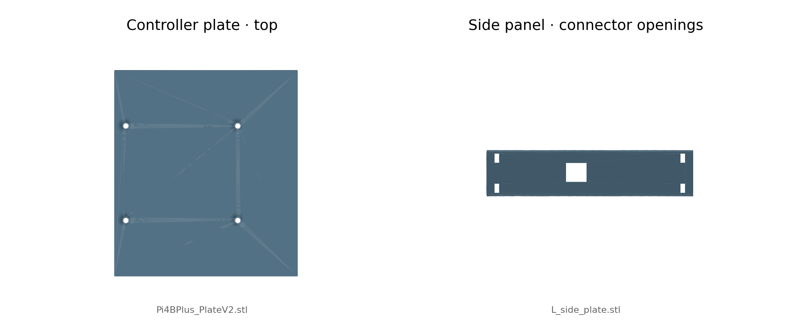

# Spot Micro

Locomotion learning for a 12-DOF Spot Micro with MG996R servos, Raspberry Pi 5, MPU-6050 and PCA9685. Trained in Isaac Lab and exported to ONNX for a 50 Hz control loop on the Pi.

[](docs/media/walk-060.mp4)

[Walking · 10 s](docs/media/walk-060.mp4) · [Gait detail · 4 s](docs/media/gait-detail.mp4) · [Training](docs/TRAINING.md) · [Pi setup](PI_SETUP.md) · [Hardware](hardware/README.md)

**Status:** simulation-validated student policy. Hardware validation of this checkpoint is pending. The footage shows a 0.6 m/s forward command on flat ground.

## Policy

A privileged-state teacher is trained with PPO, then distilled into a sensor-only student using DAgger. Training includes uneven terrain, friction and mass randomization, servo variation and external force pulses.

| Property | Value |
| --- | --- |
| Inputs | IMU, velocity command, previous filtered joint targets, gait phase |
| History | 20 frames / 400 ms |
| Network | 520 inputs, 12 outputs, 175,308 parameters |
| Control rate | 50 Hz |
| Deployment | ONNX Runtime on Raspberry Pi 5 |

The student requires no foot-contact sensors, joint encoders or measured base velocity. Checkpoint, configuration and export: [`policies/rough_student/`](policies/rough_student/).

## Simulation

Tested with **Isaac Sim 5.1, Isaac Lab 2.3.2, PyTorch 2.7 and RSL-RL 3.1.2** on an RTX 4090. The scripts use the Conda environment `unitree_sim_env`; override it with `SPOT_CONDA_ENV`.

```bash
# Early teacher checkpoint — 200 environments
bash scripts/demo_classroom.sh start

# Final student policy — 200 environments
bash scripts/demo_classroom.sh fertig

# Keyboard control — single environment, checkpoint terrain profile
bash scripts/run.sh live --checkpoint policies/rough_student/model_final.pt
```

The batch demos run on flat ground with a 0.6 m/s forward command and zero yaw. The early checkpoint is the first saved teacher state, not a randomly initialized policy.

Keyboard: **W/S** forward/reverse, **A/D** lateral, **Q/E** yaw, **Space** stop, **R** reset, **Esc** exit.

## Evaluation

32 environments, 10 seconds per command. Counts below are fall/reset events.

| Terrain | Command | Mean forward speed | Falls |
| --- | ---: | ---: | ---: |
| Flat | 0.4 m/s | 0.384 m/s | 0 |
| Flat | 0.6 m/s | 0.590 m/s | 0 |
| Rough + randomization + pushes | 0.4 m/s | 0.343 m/s | 9 |
| Rough + randomization + pushes | 0.6 m/s | 0.520 m/s | 28 |

Standing and yaw tests on flat ground also completed without falls. Rough-terrain falls decreased from 144 with the previous policy to 37; 28 additional terrain-boundary resets limit the assessment of sustained locomotion.

In separate lateral-push tests, 6.2 N pulses lasting 120 ms caused no falls. At 18.5 N and 37 N, all 32 robots fell. Full results: [`validation.json`](policies/rough_student/validation.json).

## Raspberry Pi

```bash
python3 -m venv .venv
.venv/bin/pip install -r requirements-pi.txt

# Inference benchmark, no actuator output
.venv/bin/python scripts/pi_inference.py policies/rough_student/export --benchmark 1000

# Deployment package
python scripts/package_pi.py policies/rough_student/export \
  --validation policies/rough_student/validation.json \
  --output outputs/spot_micro_pi.zip
```

Hardware commissioning covers IMU orientation, servo mapping, direction, offsets and joint limits: [PI_SETUP.md](PI_SETUP.md). Servos use a separate power supply with a common ground.

## Mechanical design

Original printed parts: **[Spotmicro – robot dog by KDY0523](https://www.thingiverse.com/thing:3445283)**. Our modifications change the controller mounting holes and side-panel connector openings. STL files: [`hardware/modified/`](hardware/modified/).



The simulation uses OpenQuadruped URDF and mesh assets with modified dynamics. Our software covers the training environment, rewards, servo model, teacher–student transfer and Pi integration. The modified print files do not automatically change the simulation geometry or inertias.

## Repository

| Path | Contents |
| --- | --- |
| `spot_micro/` | Environment, rewards, servo dynamics, runtime and drivers |
| `scripts/` | Training, evaluation, demos and deployment tools |
| `configs/` | Robot profiles and hardware calibration template |
| `policies/` | Final student, ONNX export and early teacher checkpoint |
| `assets/` | Simulation models and upstream licenses |
| `hardware/` | Modified print files |
| `tests/` | Control, observation and hardware-interface tests |

## Attribution

KDY0523 print assets retain their **CC BY 3.0** attribution. Imported OpenQuadruped files retain their **MIT** notice; mesh-specific licenses apply separately. See [THIRD_PARTY_NOTICES.md](THIRD_PARTY_NOTICES.md). No open-source license has yet been assigned to this project's original software.
