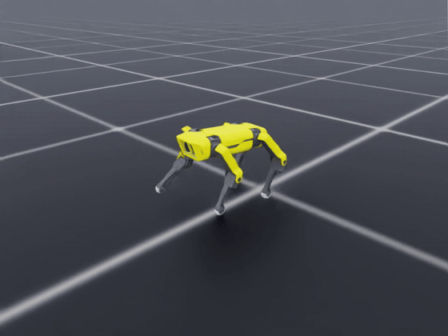

# Spot Micro

Ein 3D-gedruckter Vierbeiner mit zwölf MG996R-Servos, Raspberry Pi 5 und einer in Isaac Lab trainierten Laufsteuerung. Das Repository enthält die Simulation, das Training, die fertige Policy und die Software für MPU-6050 und PCA9685.

[](docs/media/walk-060.mp4)

**[Laufvideo · 10 s](docs/media/walk-060.mp4)** · **[Gangbild · 4 s](docs/media/gait-detail.mp4)** · [Pi einrichten](PI_SETUP.md) · [Training](docs/TRAINING.md) · [Druckteile](hardware/README.md)

Die Aufnahmen zeigen die abgenommene Student-Policy bei 0,6 m/s Sollgeschwindigkeit auf ebenem Boden. Sie stammen aus Isaac Sim. Fahrversuche mit dieser Policy am echten Roboter stehen noch aus.

## Aufbau

| Bauteil | Verwendung |
| --- | --- |
| Raspberry Pi 5 | Policy-Auswertung und Steuerung mit 50 Hz |
| 12 × MG996R | Drei Gelenke pro Bein |
| PCA9685 | PWM-Ausgabe für die Servos |
| MPU-6050 | Beschleunigung und Drehrate über I²C |
| Separate Servo-Stromversorgung | Versorgung der zwölf Servos; gemeinsame Masse mit der Steuerung |
| NVIDIA RTX 4090 | Training und Simulation auf dem PC |

Die Druckteile stammen von **[Spotmicro – robot dog von KDY0523](https://www.thingiverse.com/thing:3445283)**. Wir haben die Befestigungslöcher der Controller-Platte und die seitlichen Anschlussöffnungen angepasst. Diese beiden STL-Dateien liegen unter [`hardware/modified/`](hardware/modified/).


Laufsteuerung, Trainingsumgebung, Reward-Design, Teacher–Student-Übertragung und Pi-Anbindung sind die Software dieses Projekts. Das Simulationsmodell verwendet importierte URDF- und Mesh-Dateien von OpenQuadruped mit angepasster Dynamik. Quellen und bestehende Lizenzen stehen in [THIRD_PARTY_NOTICES.md](THIRD_PARTY_NOTICES.md).

## Simulation starten

Voraussetzung ist eine eingerichtete Umgebung mit **Isaac Sim 5.1, Isaac Lab 2.3.2, PyTorch 2.7 und RSL-RL 3.1.2**. Die getestete Conda-Umgebung heißt `unitree_sim_env`. Für einen anderen Namen vorab `export SPOT_CONDA_ENV=DEINE_UMGEBUNG` setzen. Die Einrichtung ist in [docs/TRAINING.md](docs/TRAINING.md) beschrieben.

Im Repository-Ordner:

```bash
# Früher Trainingsstand: 200 Roboter, Übersichtskamera
bash scripts/demo_classroom.sh start

# Abgenommene Policy: dieselbe Szene mit 200 Robotern
bash scripts/demo_classroom.sh fertig
```

Die erste Simulation schließen, bevor die zweite gestartet wird. Beide erhalten 0,6 m/s Vorwärtsgeschwindigkeit ohne Drehbefehl. Die Demo endet nach zehn Minuten Simulationszeit. `start` ist der erste gespeicherte Teacher-Checkpoint, kein vollständig untrainiertes Netz; `fertig` ist die Sensor-Student-Policy. Beide Checkpoints sind enthalten. Während der Vorführung wird nicht trainiert.

Für eine einzelne, per Tastatur steuerbare Simulation:

```bash
bash scripts/run.sh live --checkpoint policies/rough_student/model_final.pt
```

**W/S** vor/zurück · **A/D** seitwärts · **Q/E** drehen · **Leertaste** Stillstand · **R** zurücksetzen · **Esc** beenden. Das Simulationsfenster muss den Tastaturfokus haben. Die Live-Simulation verwendet das zum Checkpoint gehörende Geländeprofil.

## Was die Policy kann

Die Student-Policy nutzt eine 400-ms-Historie aus IMU-Daten, Fahrbefehl, bisherigen Sollwinkeln und internem Phasensignal. Sie bekommt weder Fußkontakte noch gemessene Gelenkwinkel oder eine tatsächliche Vorwärtsgeschwindigkeit. Das Netz hat 520 Eingaben, zwölf Ausgaben und 175.308 Parameter.

Die abschließenden Tests liefen jeweils mit **32 Robotern für zehn Sekunden pro Fahrbefehl**:

| Test | Soll | Gemessene Vorwärtsgeschwindigkeit | Sturz-Resets |
| --- | ---: | ---: | ---: |
| Ebene | 0,4 m/s | 0,384 m/s | 0 |
| Ebene | 0,6 m/s | 0,590 m/s | 0 |
| Unebener Boden, Reibungsstreuung und Stöße | 0,4 m/s | 0,343 m/s | 9 |
| Unebener Boden, Reibungsstreuung und Stöße | 0,6 m/s | 0,520 m/s | 28 |

Auch Stehen und Drehen blieben auf der Ebene in diesen Tests sturzfrei. Im Geländetest sank die Summe der Sturz-Resets von 144 bei der vorherigen Policy auf 37. Zusätzlich gab es 28 Resets an den Geländegrenzen. Ein Roboter kann mehrfach stürzen; die Zahlen sind Ereignisse, keine Prozentwerte.

Seitenstöße von etwa 6,2 N über 120 ms wurden im separaten Test abgefangen. Bei etwa 18,5 N und 37 N über dieselbe Dauer fielen alle 32 Roboter. Die Ergebnisse sind Simulationsergebnisse und keine Belastungsfreigabe für den realen Aufbau. Vollständige Messwerte: [`policies/rough_student/validation.json`](policies/rough_student/validation.json).

## Auf dem Raspberry Pi

Die exportierte Policy liegt in [`policies/rough_student/export/`](policies/rough_student/export/). Auf dem Pi werden weder Isaac Sim noch eine NVIDIA-GPU benötigt.

```bash
python3 -m venv .venv
.venv/bin/pip install -r requirements-pi.txt
.venv/bin/python scripts/pi_inference.py policies/rough_student/export --benchmark 1000
```

Der Benchmark bewegt keine Motoren. Vor dem ersten Lauf müssen IMU-Ausrichtung, Servo-Kanäle, Drehrichtungen, Nullstellungen und Bewegungsgrenzen zum realen Aufbau passen. Die Schritte stehen in [PI_SETUP.md](PI_SETUP.md).

Ein separates Paket für den Pi lässt sich so erzeugen:

```bash
python scripts/package_pi.py policies/rough_student/export \
  --validation policies/rough_student/validation.json \
  --output outputs/spot_micro_pi.zip
```

## Projektstruktur

| Ordner | Inhalt |
| --- | --- |
| `spot_micro/` | Simulation, Rewards, Servomodell, Policy-Laufzeit und Hardwaretreiber |
| `scripts/` | Training, Auswertung, Demos und Pi-Werkzeuge |
| `configs/` | Roboterprofile und Beispiel für die Hardwarekalibrierung |
| `policies/` | Abgenommene Student-Policy und früher Teacher für die Demo |
| `assets/` | Simulationsmodelle mit Quellen und Lizenzhinweisen |
| `hardware/` | Angepasste Druckteile |
| `tests/` | Tests für Steuerung, Beobachtungen und Hardwareanbindung |
| `docs/` | Training, Veröffentlichungsnotizen, Videos und Bilder |

Lokale Trainingsläufe, Messreihen, Zugangsdaten und die individuelle Hardwarekalibrierung werden nicht versioniert. Die Checkpoints für die Demo und der Pi-Export sind ausdrücklich in `policies/` enthalten.

## Quellen und Nutzungsrechte

Die Originaldruckteile von KDY0523 sind in den übernommenen Lizenzhinweisen als **CC BY 3.0** ausgewiesen. Die übernommenen OpenQuadruped-Dateien enthalten ihre MIT-Lizenz. Änderungen an den Druckteilen sind in [hardware/README.md](hardware/README.md) dokumentiert. Für die eigenen Softwareanteile wurde bislang keine zusätzliche Open-Source-Lizenz festgelegt; die Drittanbieter-Lizenzen gelten nur für die jeweils zugeordneten Dateien.
