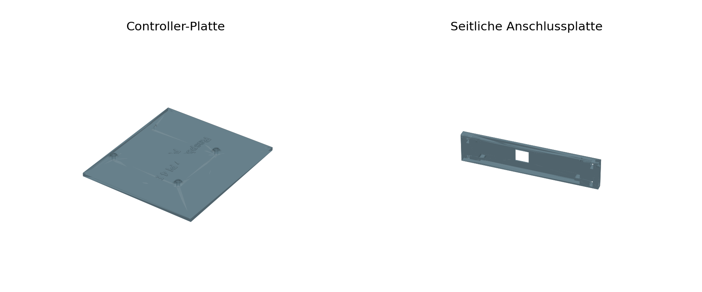

# Angepasste Druckteile

Ausgangspunkt: [Spotmicro – robot dog von KDY0523](https://www.thingiverse.com/thing:3445283).

| Datei | Änderung in unserem Aufbau |
| --- | --- |
| [Pi4BPlus_PlateV2.stl](modified/Pi4BPlus_PlateV2.stl) | Angepasste Befestigungslöcher der Controller-Platte |
| [L_side_plate.stl](modified/L_side_plate.stl) | Angepasste seitliche Anschlussöffnungen |

Die Dateinamen entsprechen den bereitgestellten Dateien. `Pi4BPlus` im Dateinamen bezeichnet nicht die aktuell verwendete Recheneinheit: Der Roboter ist für einen Raspberry Pi 5 vorgesehen. Vor dem Druck die Lochpositionen am eigenen Aufbau prüfen. Die STL-Dateien enthalten keine normierte Einheitenangabe; die Zahlenwerte sind für den Import als Millimeter vorgesehen. Abmessungen: Controller-Platte ungefähr 95 × 107 × 5,4 mm; Seitenplatte 6,5 × 130 × 29 mm.

Die Änderungen wurden vom Projektteam bereitgestellt. Originaldesign: KDY0523, CC BY 3.0 laut mitgeliefertem Lizenzhinweis. Siehe [Lizenzhinweis](../assets/spot_micro_original/stl/LICENSE.txt) und [CC BY 3.0](https://creativecommons.org/licenses/by/3.0/). Die übrigen Originaldruckteile sind auf Thingiverse erhältlich. Die Simulationsmeshes unter `assets/` werden durch diese Fertigungsdateien nicht automatisch ersetzt; ihre Masseneigenschaften wurden nicht neu aus den geänderten Teilen berechnet.

